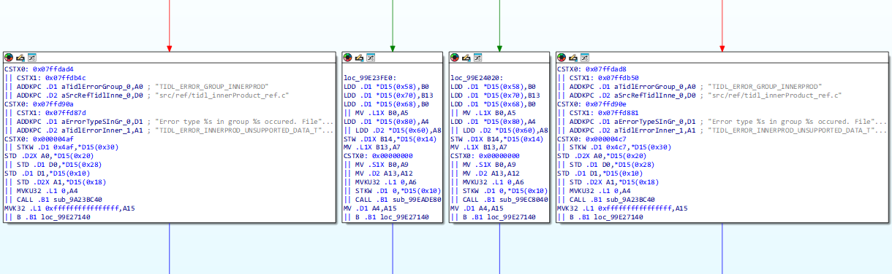
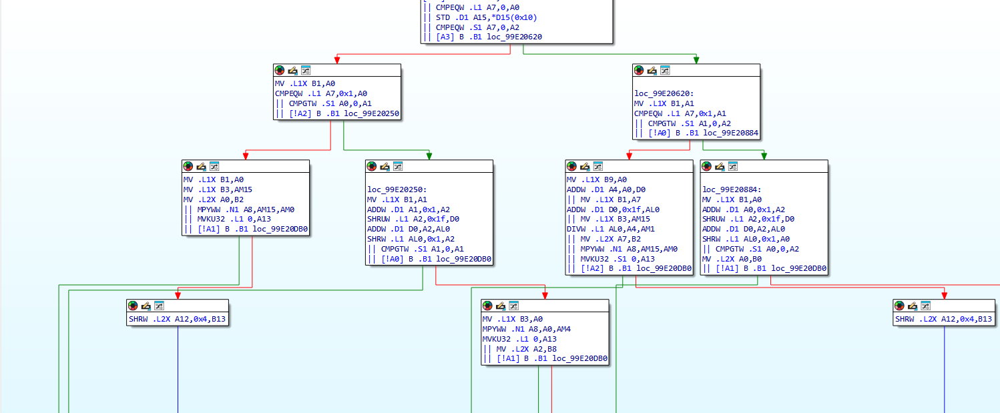
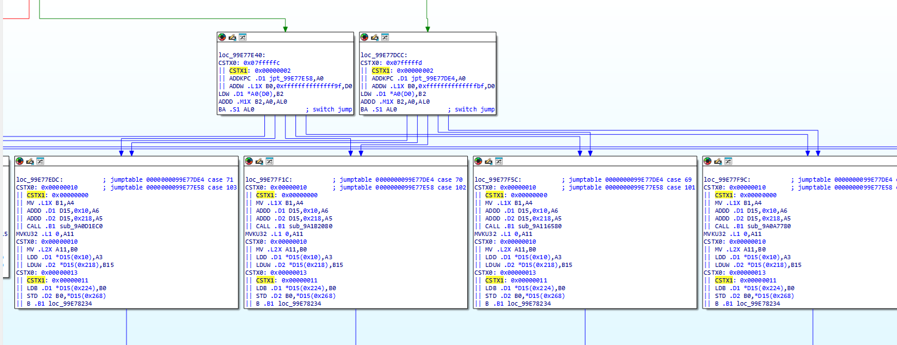

# C7x IDA Support Package

Native Texas Instruments C7x analysis for IDA Pro 8.4 (ida64.exe).

The cx7_64.dll processor module decodes C7x firmware into instructions, registers,
operands, and execution packets, with analysis of branches, calls, returns,
switch tables, and memory references.

## Supported processors

- C7100 (`c7x`)
- C7120 (`c7120`)
- C7504 (`c7504`)
- C7524 (`c7524`)

For a new ELF, select the C7x processor family initially. The appropriate
supported processor version is then selected automatically.
For raw binaries, select the processor version manually. Existing databases may
need processor selection and code reanalysis when changing versions.

## What you get

- Instruction disassembly with mnemonics, registers, and operands
- Scalar and vector registers, immediate operands, and memory addressing
- Conditional instructions, parallel packet display (`||`), and constant extensions
- Control-flow analysis for direct calls, branches, returns, and supported switch idioms
- Function names for resolved direct calls and symbols for ADDKPC targets
- Data references for supported loads, stores, and address calculations
- IDA display formats for immediate operands, including character representation
- Python support for custom instruction analysis in IDA

The TI compiler tools are not required to use the processor module.

## Screenshots

### Data references

Resolved data references show strings alongside the instructions that use them.

### Control flow

IDA's graph view shows conditional branches and the paths between code blocks.

### Switch recognition

Recognized switch tables connect indirect jumps to their case blocks.

## Quick start

1. Download the release ZIP and extract it into a writable directory.
2. Set `C7X_IDA_HOME` in your environment or edit `cmd\c7x_setenv.cmd` in the
   extracted package to point to the directory containing IDA Pro 8.4's `ida64.exe`.
3. Run `cmd\c7x_ida.cmd "path\to\firmware.out"`, or run it without a filename
   and open the firmware in IDA.
4. Verify the selected C7x processor version matches the firmware.

The launcher uses the extracted directory as IDA's user directory and does not
modify the IDA installation. Keep the package files together when moving it.

## Python tools

Use `python\c7x_defs.py` in your IDAPython scripts for custom C7x analysis.

## Documentation

TI's C7000 CPU, Instruction Set, and Matrix Multiply Accelerator Reference Guide
(SPRUIP0) provides architectural background. Some instruction families are
covered under generic names; it is not a complete individual-instruction help
reference. An integrated instruction-help plugin is not currently included.

## Terms of use

By downloading, installing, or using this package, you accept the terms in
[LICENSE.md](LICENSE.md).

Author: [mr.wolf.is.me@gmail.com](mailto:mr.wolf.is.me+c7x_ida@gmail.com)

